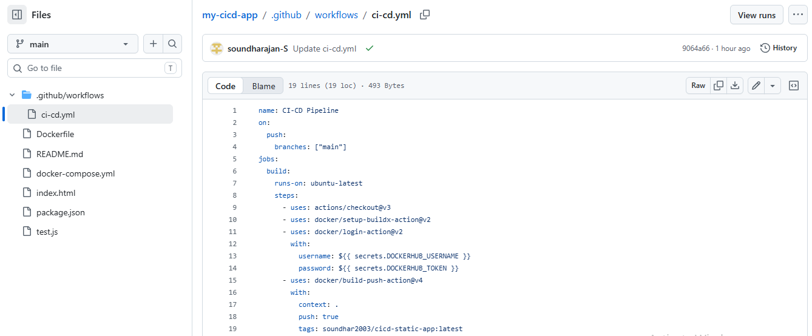

# CI/CD Pipeline - No Cloud Needed

**Project 7** | Repo: github.com/soundhar2003/cicd-static-app | Image: hub.docker.com/r/soundhar2003/cicd-static-app | Live: http://localhost:8080 | Build: 16 Oct 2026 15:04:45 IST

### 1. Introduction
Manual deployment inefficient. This project implements complete CI/CD without cloud, using free tools. Push to GitHub triggers Actions, builds Docker image, pushes to Hub, runs locally.

### 2. Steps
1. Push to GitHub -> 2. Actions builds image -> 3. Pushes to Docker Hub -> 4. Pull & Run Locally

### 3. How to Run Locally

### 4. Screenshots

#### GitHub Repo + Workflow File

#### GitHub Actions - Green Tick (MAIN PROOF)

#### Docker Hub Image Pushed

#### Deployed App - Wonderful UI (Final Proof)

#### Terminal Verification

### 5. Build Details
- Build: 16 Oct 2026 15:04:45 IST
- Image Size: 27.47 MB
- Platform: linux/amd64
- Status: LIVE & DEPLOYED
