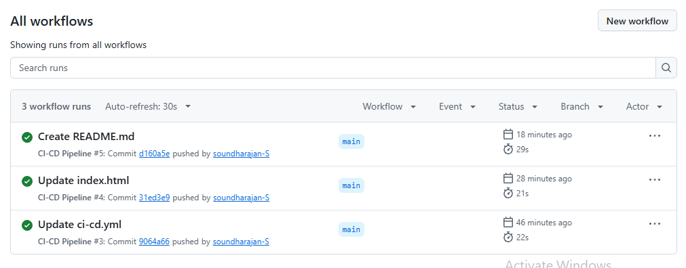
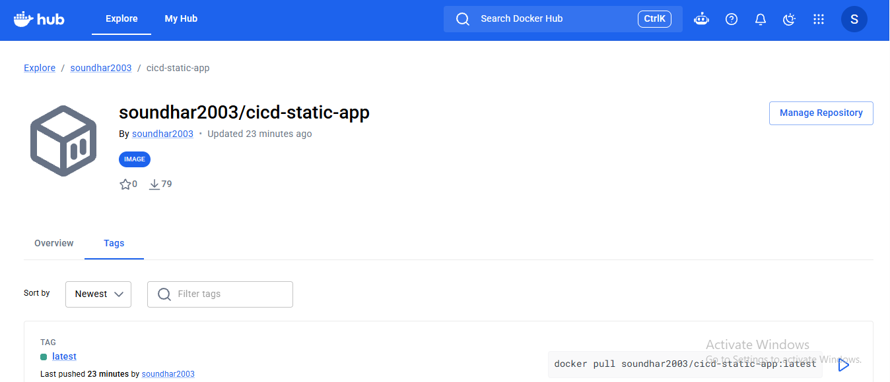
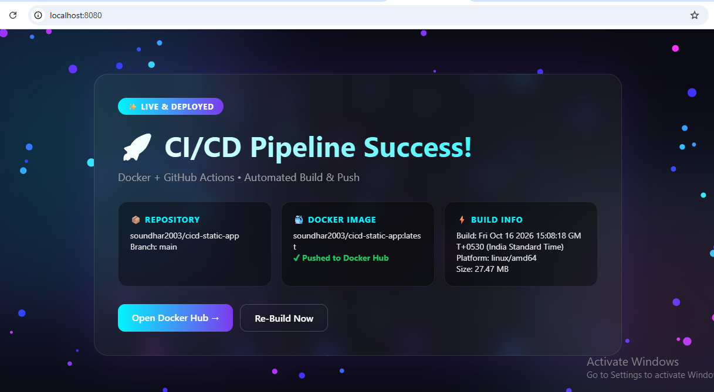
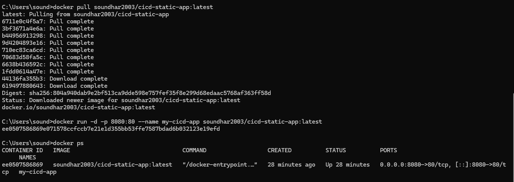

# CI/CD Pipeline - No Cloud Needed

**Project 4 | Build: 16 Oct 2026 15:04:45 IST | Image: 27.47 MB | Live: http://localhost:8080**

### Workflow
Push to GitHub -> GitHub Actions builds Docker Image -> Pushes to Docker Hub -> Pull & Run Locally

### How to Run
docker pull soundhar2003/cicd-static-app:latest
docker run -d -p 8080:80 --name my-cicd-app soundhar2003/cicd-static-app:latest
Open localhost:8080

### Screenshots

#### 1. GitHub Repo

#### 2. GitHub Actions - Green Tick (MAIN PROOF)

#### 3. Docker Hub Image

#### 4. Deployed App - Final Proof

#### 5. Terminal Verification

